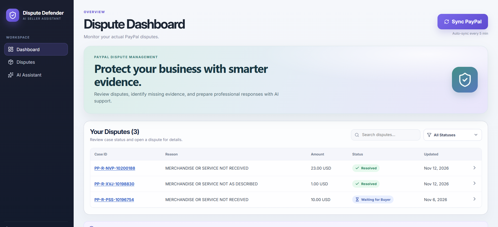
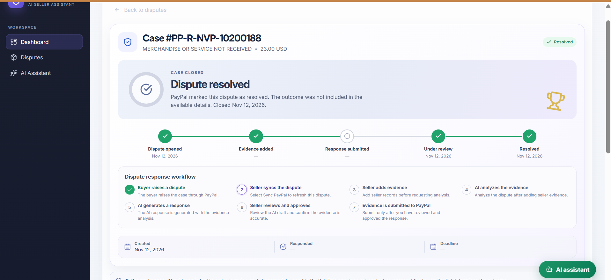
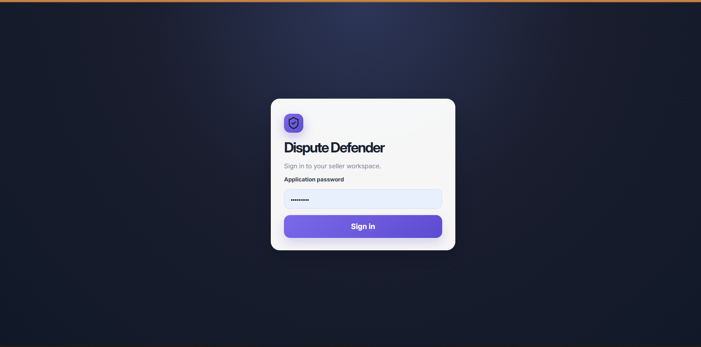
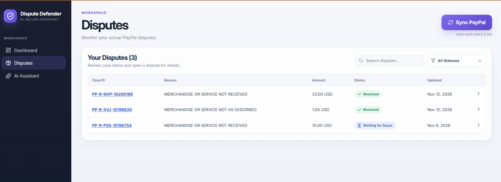
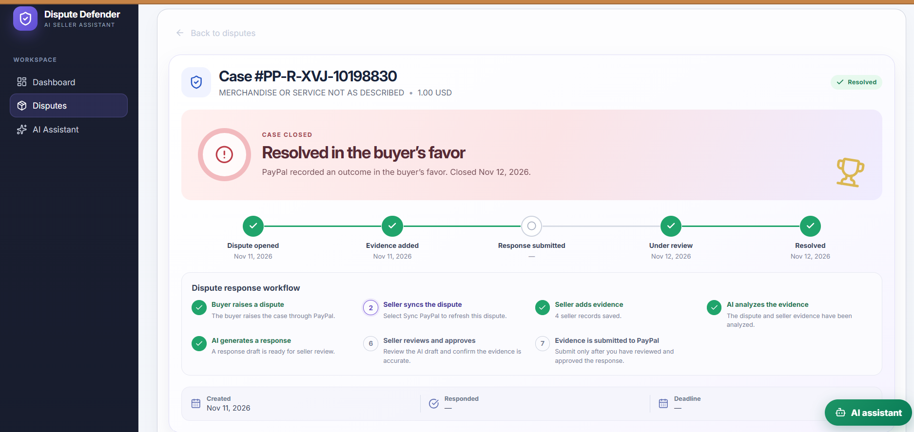
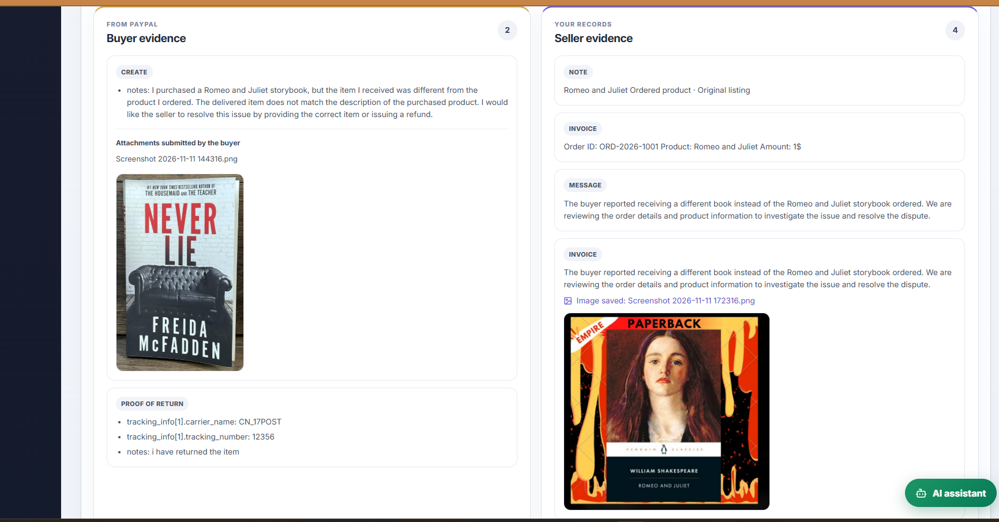
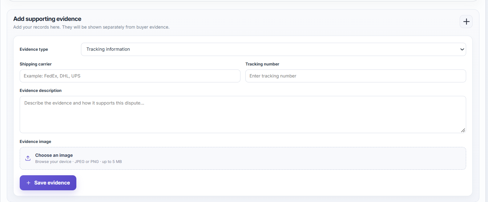
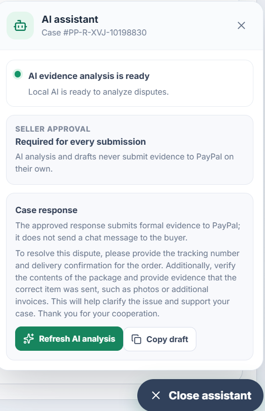
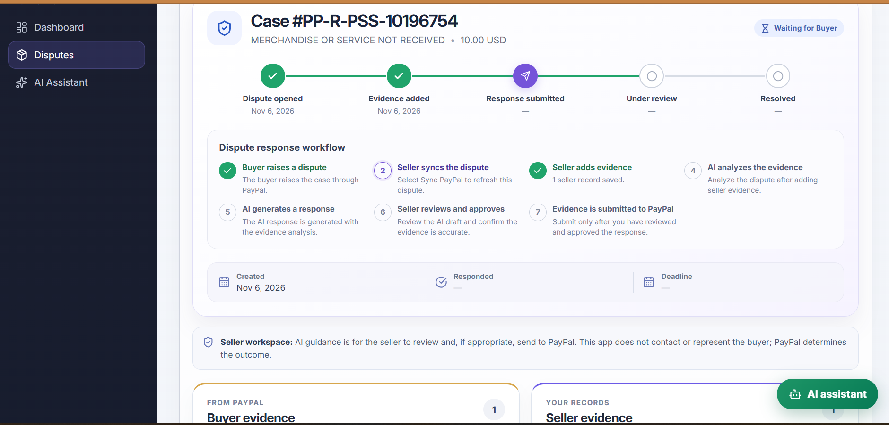

# Dispute Defender

A seller workspace for handling PayPal payment disputes. It pulls in disputes from PayPal, lets the seller add evidence, uses a **local AI model** to review the case and draft a reply, and submits evidence to PayPal **only after the seller approves it**.

> **The seller is always in control.** Nothing syncs, analyzes, or submits in the background. Every step is started by the seller.

<!-- SCREENSHOT 1 (HERO): Full dashboard view.
     Save as: docs/screenshots/dashboard.png -->


---

## Table of Contents

- [What it does](#what-it-does)
- [How the workflow works](#how-the-workflow-works)
- [Screenshots](#screenshots)
- [Tech stack](#tech-stack)
- [Project structure](#project-structure)
- [Before you start](#before-you-start)
- [Setup](#setup)
- [Environment variables](#environment-variables)
- [Running the app](#running-the-app)
- [Testing with PayPal Sandbox](#testing-with-paypal-sandbox)
- [API endpoints](#api-endpoints)
- [Important limits](#important-limits)
- [Security notes](#security-notes)
- [Scripts](#scripts)

---

## What it does

- **Sync disputes** from your PayPal Business account
- **Add evidence** to each case: tracking info, invoice, messages, seller notes, plus one JPEG/PNG image per record (max 5 MB)
- **See buyer and seller evidence side by side**
- **AI analysis** (runs on your own machine using Ollama, no paid API key):
  - Summary of the case
  - What the buyer is claiming
  - Review of your evidence
  - Conflicts between the two sides
  - Recommended next steps
  - Evidence gaps
  - A draft reply
- **Review, edit, and approve** the reply before anything is sent
- **Submit to PayPal** once you confirm everything is accurate
- **Track progress** through a 7-step timeline on every case

## How the workflow works

1. Buyer raises a dispute in PayPal
2. Seller clicks **Sync PayPal**
3. Seller adds evidence
4. AI analyzes the evidence
5. AI writes a draft response
6. Seller reviews and approves
7. Evidence is submitted to PayPal

<!-- SCREENSHOT: The 7-step timeline / "Dispute response workflow" section on a case page.
     Save as: docs/screenshots/workflow.png -->


---

## Screenshots

Add these images to `docs/screenshots/`. Placeholders are already in place below.

### Login
<!-- SCREENSHOT: Sign-in screen where the app password is entered.
     Save as: docs/screenshots/login.png -->


### Disputes list
<!-- SCREENSHOT: Disputes table with the status filter and "Sync PayPal" button.
     Save as: docs/screenshots/disputes-list.png -->


### Case details
<!-- SCREENSHOT: Top of a case page (case number, status, amount, timeline).
     Save as: docs/screenshots/case-details.png -->


### Buyer vs. seller evidence
<!-- SCREENSHOT: The two-column "Buyer evidence" / "Seller evidence" section.
     Save as: docs/screenshots/evidence-comparison.png -->


### Adding evidence
<!-- SCREENSHOT: The "Add supporting evidence" form with an image attached.
     Save as: docs/screenshots/add-evidence.png -->


### AI analysis
<!-- SCREENSHOT: The "Evidence analysis" section showing summary, buyer claims,
     conflicts, next steps, gaps, and the draft reply.
     Save as: docs/screenshots/ai-analysis.png -->


### Review and approve
<!-- SCREENSHOT: The "Review and approve response" section with the Submit to PayPal button.
     Save as: docs/screenshots/review-approve.png -->


### AI Assistant page
<!-- SCREENSHOT: The "AI Assistant" page showing the "Local AI status" panel.
     Save as: docs/screenshots/ai-assistant.png -->


---

## Tech stack

| Part | What is used |
|------|--------------|
| Frontend | React 19, TypeScript, Vite, lucide-react icons |
| Backend | Node.js, Express 5, TypeScript |
| Database | SQLite (via `better-sqlite3`) |
| File uploads | Multer (kept in memory, saved to the database) |
| AI | Ollama running locally (default model: `qwen2.5:7b`) |
| Payments data | PayPal Customer Disputes API |
| Tests | Node test runner (backend), Vitest (frontend) |

## Project structure

```
dispute-defender/
├── backend/
│   ├── src/
│   │   ├── server.ts            # API routes and login check
│   │   ├── paypal.ts            # Talks to the PayPal API
│   │   ├── ai.ts                # Talks to Ollama
│   │   ├── rules.ts             # Evidence scoring rules
│   │   ├── evidenceMatching.ts  # Matches PayPal requests to your evidence
│   │   ├── db.ts                # SQLite tables and queries
│   │   ├── type.ts              # Shared data types
│   │   └── *.test.ts            # Tests
│   ├── .env.example
│   └── package.json
└── frontend/
    ├── src/
    │   ├── App.tsx              # Main screens
    │   ├── App.css              # Styles
    │   ├── api.ts               # Calls to the backend
    │   ├── workflow.ts          # 7-step timeline logic
    │   └── workflow.test.ts
    └── package.json
```

---

## Before you start

You need:

- **Node.js** (current LTS version)
- **Ollama**: [ollama.com/download](https://ollama.com/download)
- A **PayPal Developer account** with Sandbox test accounts (one Business, one Personal)

## Setup

### 1. Get the code

```bash
git clone <your-repo-url>
cd dispute-defender
```

### 2. Set up the AI model

```bash
ollama pull qwen2.5:7b
```

Make sure Ollama is running. A 7B model needs a fair amount of memory and can be slow on a computer without a strong GPU.

### 3. Set up PayPal Sandbox

1. Open the [PayPal Developer Dashboard](https://developer.paypal.com/dashboard/)
2. Create or pick one Sandbox **Business** account (the seller) and one Sandbox **Personal** account (the buyer)
3. Go to **Apps & Credentials**, choose **Sandbox**, and create a REST app for the Business account
4. Copy the Sandbox **Client ID** and **Secret**

### 4. Set up the backend

```bash
cd backend
npm install
cp .env.example .env
```

Open `.env` and fill in your values (see the table below).

### 5. Set up the frontend

```bash
cd ../frontend
npm install
```

---

## Environment variables

Set these in `backend/.env`:

| Variable | Required | Default | What it does |
|----------|----------|---------|--------------|
| `APP_PASSWORD` | Yes | none | Password you type to sign in to the app |
| `PAYPAL_ENV` | No | `sandbox` | Use `sandbox` for testing. `live` uses real PayPal |
| `PAYPAL_CLIENT_ID` | Yes | none | Your PayPal REST app client ID |
| `PAYPAL_CLIENT_SECRET` | Yes | none | Your PayPal REST app secret |
| `OLLAMA_BASE_URL` | No | `http://127.0.0.1:11434` | Where Ollama is running |
| `OLLAMA_MODEL` | No | `qwen2.5:7b` | Which AI model to use |
| `PORT` | No | `3001` | Backend port |
| `FRONTEND_ORIGIN` | No | `http://localhost:5173` | Frontend address allowed to call the backend |

> ⚠️ Keep `PAYPAL_ENV` on `sandbox` while testing. Never use live credentials in a test setup, and never commit `.env`.

---

## Running the app

Open two terminals.

**Terminal 1: backend**
```bash
cd backend
npm run dev
```
Runs at http://localhost:3001

**Terminal 2: frontend**
```bash
cd frontend
npm run dev
```
Runs at http://localhost:5173

Sign in with the `APP_PASSWORD` you set. This is **not** your PayPal password.

To check that the AI is working, open the **AI Assistant** page. If the model is missing, it shows the exact `ollama pull` command to run.

---

## Testing with PayPal Sandbox

This app **cannot create payments or disputes**. You need to create them in PayPal first.

1. Make a Sandbox payment to your Business account, paying as the Personal buyer (use a PayPal Sandbox checkout or sample app)
2. Raise a dispute on that payment using PayPal's Sandbox tools, if your account allows it
3. In Dispute Defender, click **Sync PayPal**
4. Open the dispute and add your evidence
5. Click **Analyze evidence**
6. Review and edit the draft, confirm it is accurate, then click **Submit to PayPal**
7. Check the result in both Dispute Defender and PayPal

Notes:

- Creating a payment alone does **not** create a dispute
- Sandbox does not always behave like live PayPal
- Mark all test tracking numbers and text clearly as fictional
- If Sandbox will not let the buyer raise a dispute, you cannot test the full flow. Use a PayPal-provided test dispute if you have one

---

## API endpoints

All `/api` routes need the header `x-app-password`.

| Method | Route | What it does |
|--------|-------|--------------|
| GET | `/health` | Check the server is up (no password needed) |
| GET | `/api/ai/status` | Check Ollama and the model |
| POST | `/api/sync` | Pull disputes from PayPal |
| GET | `/api/disputes` | List all disputes |
| GET | `/api/disputes/:id` | Get one dispute |
| POST | `/api/disputes/:id/evidence` | Add evidence (with optional image) |
| POST | `/api/disputes/:id/analyze` | Run AI analysis |
| POST | `/api/disputes/:id/submit` | Submit evidence to PayPal |
| POST | `/api/disputes/:id/submission-attempt/reconcile` | Resolve a submission that needs checking |

---

## Important limits

Read these before relying on the AI output.

- **The AI does not predict who will win.** PayPal decides the outcome.
- **The score is not a win chance.** It only shows how complete your evidence looks.
- **The AI cannot see images or documents.** It only reads file names and text.
- **Buyer statements are treated as claims**, not facts.
- **Always check the AI draft** before submitting. It can be wrong.
- **Changing evidence or syncing new PayPal details clears the old analysis.** You must analyze again.
- **Analysis needs at least one piece of seller evidence.** The server blocks it otherwise.
- **Escalated cases are not supported.** For chargeback, pre-arbitration, and arbitration stages, follow PayPal's own instructions. This app does not submit evidence at those stages.
- **Buyer image previews may not load.** PayPal offers downloadable buyer attachments only as a limited-release feature.
- **Image upload and details are sent separately.** If the image uploads but the details are not confirmed, check the case in PayPal before retrying. Otherwise you may send the same evidence twice.
- **Evidence images:** JPEG or PNG only, 5 MB max, one per record.
- **The app does not contact the buyer.** It only works on the seller's side.

---

## Security notes

- The app uses **one shared password**, sent with every request. It is meant for **local use and demos**, not for the public internet.
- Evidence and images are stored in a local SQLite file (`dispute-defender.db`). Anyone with access to your computer can read it.
- Do not commit `.env` or `*.db` files. They are already in `.gitignore`.
- Do not deploy this with live PayPal credentials until you add real user accounts, HTTPS, and proper secret storage.

---

## Scripts

**Backend** (`backend/`)

| Command | What it does |
|---------|--------------|
| `npm run dev` | Start with auto-reload |
| `npm run build` | Compile TypeScript to `dist/` |
| `npm start` | Run the compiled server |
| `npm test` | Run tests |

**Frontend** (`frontend/`)

| Command | What it does |
|---------|--------------|
| `npm run dev` | Start the dev server |
| `npm run build` | Build for production |
| `npm run preview` | Preview the production build |
| `npm run lint` | Check code with Oxlint |
| `npm test` | Run tests |

---

## License

Add your license here. `backend/package.json` currently says ISC, but there is no LICENSE file.
